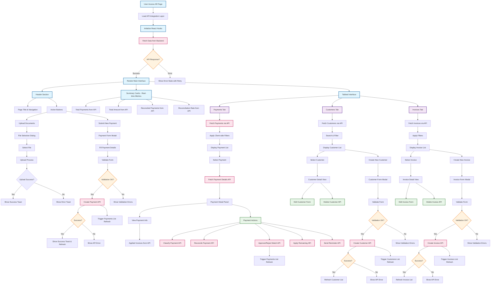

# Accounts Receivable Frontend Redesign Documentation

## Overview

This document outlines the comprehensive redesign of the Accounts Receivable (AR) frontend to integrate with the backend API service. The redesign transforms the static, mock-data driven interface into a fully functional system that leverages real-time data from the AR service.

## Key Changes Implemented

### 1. **API Integration Layer** (`/lib/ar-api.ts`)

**Created a comprehensive API integration layer with:**

- **Type Definitions**: Proper TypeScript interfaces matching backend schemas
- **API Functions**: Dedicated modules for customers, invoices, and payments
- **React Hooks**: Custom hooks for data fetching and state management
- **Error Handling**: Robust error handling with APIError class
- **Utility Functions**: Helper functions for formatting and calculations

**Available API Endpoints Integrated:**

#### Customers API
- `POST /api/v1/customers` - Create customer
- `GET /api/v1/customers` - List customers (with tenant filtering)
- `GET /api/v1/customers/{id}` - Get customer by ID
- `PUT /api/v1/customers/{id}` - Update customer
- `DELETE /api/v1/customers/{id}` - Delete customer

#### Invoices API
- `POST /api/v1/invoices` - Create invoice
- `GET /api/v1/invoices/{id}` - Get invoice by ID
- `GET /api/v1/invoices/by_customer/{customer_id}` - Get customer invoices
- `PUT /api/v1/invoices/{id}` - Update invoice
- `DELETE /api/v1/invoices/{id}` - Delete invoice

#### Payments API
- `POST /api/v1/payments` - Create payment
- `GET /api/v1/payments` - List payments (with filtering)
- `GET /api/v1/payments/{id}` - Get payment with applied invoices
- `GET /api/v1/payments/by_customer/{customer_id}` - Get customer payments
- `PUT /api/v1/payments/{id}` - Update payment
- `DELETE /api/v1/payments/{id}` - Delete payment
- `POST /api/v1/payments/{id}/classify` - Classify payment
- `POST /api/v1/payments/{id}/reconcile` - Reconcile payment
- `POST /api/v1/payments/{id}/approve_match` - Approve match
- `POST /api/v1/payments/{id}/reject` - Reject payment
- `POST /api/v1/payments/{id}/apply_remaining` - Apply remaining balance
- `POST /api/v1/payments/{id}/send_reminder` - Send reminder

### 2. **Frontend Component Redesign** (`page-new.tsx`)

**Replaced static mock data with dynamic API integration:**

#### State Management Transformation
- **Before**: Static arrays with hardcoded data
- **After**: React hooks managing API state (loading, error, data)

#### Data Flow Improvements
- **Real-time Updates**: Components automatically refresh when data changes
- **Optimistic Updates**: UI updates immediately on successful operations
- **Error Boundaries**: Proper error handling and user feedback

#### User Experience Enhancements
- **Loading States**: Skeleton loaders and spinners during API calls
- **Error Messages**: Clear error feedback with retry options
- **Success Notifications**: Toast notifications for successful operations
- **Form Validation**: Client-side validation before API submission

## Revised Workflow Diagram



## Business Process Alignment

### 1. **Order-to-Cash (O2C) Process Integration**

The redesigned interface now properly supports the complete O2C process:

#### Stage 1: Customer Management
- Create and manage customer records
- Set credit limits and payment terms
- Track customer communication details

#### Stage 2: Invoice Creation
- Generate invoices for delivered goods/services
- Set payment terms and due dates
- Include tax calculations and descriptions

#### Stage 3: Payment Processing
- Record incoming payments
- Automatic classification and matching
- Manual reconciliation when needed

#### Stage 4: Collections Management
- Track overdue invoices
- Send payment reminders
- Apply payments to outstanding invoices

### 2. **Advanced Payment Features**

#### Payment Classification
- Automatic invoice matching using AI/ML
- Confidence scoring for match recommendations
- Manual override capabilities

#### Reconciliation Engine
- Apply payments to multiple invoices
- Handle partial payments
- Track remaining balances

#### Collections Workflow
- Automated reminder scheduling
- Payment plan creation
- Dispute management

## Technical Architecture

### 1. **API Layer Architecture**

```
lib/ar-api.ts
├── Types & Interfaces
│   ├── Customer, CustomerCreate
│   ├── Invoice, InvoiceCreate
│   ├── Payment, PaymentCreate
│   └── Supporting types
├── API Functions
│   ├── customerAPI object
│   ├── invoiceAPI object
│   └── paymentAPI object
├── React Hooks
│   ├── useCustomers()
│   ├── useInvoices()
│   └── usePayments()
└── Utility Functions
    ├── formatCurrency()
    ├── formatDate()
    ├── getStatusColor()
    └── calculateDaysOverdue()
```

### 2. **Component Architecture**

```
page-new.tsx
├── State Management
│   ├── Component state (activeTab, selectedItem, etc.)
│   ├── Form states (newPayment, newCustomer, newInvoice)
│   └── Filter states
├── API Integration
│   ├── useCustomers hook
│   ├── useInvoices hook
│   └── usePayments hook
├── Event Handlers
│   ├── CRUD operations
│   ├── Form submissions
│   └── UI interactions
└── Render Logic
    ├── Header with actions
    ├── Summary cards
    ├── Tabbed interface
    └── Detail panels
```

## User Experience Improvements

### 1. **Real-time Data**
- All data fetched from live backend APIs
- Automatic refresh on data changes
- Optimistic updates for better responsiveness

### 2. **Enhanced Error Handling**
- Clear error messages for API failures
- Retry mechanisms for failed requests
- Graceful degradation for network issues

### 3. **Loading States**
- Skeleton loaders during data fetching
- Progress indicators for long operations
- Disabled states during processing

### 4. **Form Validation**
- Client-side validation before API calls
- Real-time validation feedback
- Consistent error messaging

## Migration Strategy

### Phase 1: API Integration (Completed)
- ✅ Created comprehensive API integration layer
- ✅ Implemented React hooks for data management
- ✅ Added error handling and loading states

### Phase 2: Component Redesign (Completed)
- ✅ Redesigned main AR page component
- ✅ Replaced mock data with API integration
- ✅ Updated state management patterns

### Phase 3: Testing & Validation (Recommended)
- Test all CRUD operations
- Validate error handling scenarios
- Performance testing with real data

### Phase 4: Deployment (Recommended)
- Gradual rollout with feature flags
- Monitor API performance
- User acceptance testing

## Benefits of the Redesign

### 1. **Functional Completeness**
- All backend API endpoints integrated
- Full CRUD operations for all entities
- Advanced payment processing features

### 2. **Scalability**
- Efficient API calls with proper caching
- Optimized re-renders with React hooks
- Modular architecture for future enhancements

### 3. **Maintainability**
- Clear separation of concerns
- Type-safe API integration
- Comprehensive error handling

### 4. **User Experience**
- Real-time data updates
- Intuitive workflows
- Professional error handling

## Next Steps

1. **Replace Original Component**: Update `page.tsx` to use the new implementation
2. **Add Unit Tests**: Create tests for API functions and React hooks
3. **Performance Optimization**: Implement caching and pagination
4. **Additional Features**: Add export functionality, bulk operations
5. **Documentation**: Update user guides and API documentation

This redesign transforms the AR interface from a static demonstration into a fully functional, production-ready application that seamlessly integrates with the backend services while providing an optimal user experience aligned with AR business processes.