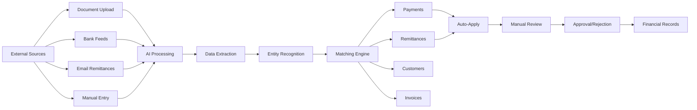

# Accounts Receivable Workflow Diagram

## Overview
The Accounts Receivable (AR) page provides a comprehensive interface for managing customer payments, remittances, customer data, and invoices. The workflow is organized around four main tabs with interconnected functionality.

```mermaid
flowchart TD
    A[User Access AR Page] --> B[Loading State with Skeletons]
    B --> C[Main AR Interface Loads]

    C --> D[Header Section]
    D --> D1[Page Title & Description]
    D --> D2[Action Buttons]
    D2 --> D3[Upload Documents]
    D2 --> D4[Submit New Payment]

    C --> E[Summary Cards]
    E --> E1[Total Payments]
    E --> E2[Pending Review]
    E --> E3[Total Amount]
    E --> E4[Auto-Apply Rate]

    C --> F[Tabbed Interface]
    F --> G[Payments Tab]
    F --> H[Remittances Tab]
    F --> I[Customers Tab]
    F --> J[Invoices Tab]

    %% Payments Workflow
    G --> G1[View Payments List]
    G1 --> G2[Apply Filters]
    G2 --> G2a[Date Range]
    G2 --> G2b[Customer]
    G2 --> G2c[Status]
    G1 --> G3[Select Payment]
    G3 --> G4[Payment Detail Panel]
    G4 --> G5[View Payment Details]
    G5 --> G5a[Payment Info]
    G5 --> G5b[Applied Invoices]
    G5 --> G5c[Unmatched Balance]
    G4 --> G6[Payment Actions]
    G6 --> G6a[Apply Remaining]
    G6 --> G6b[Send Reminder]
    G6 --> G6c[Reclassify Payment]
    G1 --> G7[Export Aging Report]

    %% Remittances Workflow
    H --> H1[View Remittances List]
    H1 --> H2[Apply Filters]
    H2 --> H2a[Date Range]
    H2 --> H2b[Customer]
    H2 --> H2c[File Type]
    H1 --> H3[Select Remittance]
    H3 --> H4[Remittance Detail Panel]
    H4 --> H5[View Remittance Details]
    H5 --> H5a[Remittance Info]
    H5 --> H5b[Extracted Fields]
    H5 --> H5c[Match Suggestions]
    H4 --> H6[Remittance Actions]
    H6 --> H6a[Review & Reconcile]
    H6 --> H6b[Reject Remittance]

    %% Customers Workflow
    I --> I1[Customers List View]
    I1 --> I2[Search Customers]
    I1 --> I3[Select Customer]
    I3 --> I4[Customer Detail View]
    I4 --> I5[View Customer Info]
    I4 --> I6[Edit Customer]
    I4 --> I7[Delete Customer]
    I1 --> I8[Create New Customer]
    I8 --> I9[Customer Form Modal]
    I9 --> I10[Validate & Save]
    I10 --> I11{Save Success?}
    I11 -->|Yes| I12[Return to List]
    I11 -->|No| I13[Show Error]

    %% Invoices Workflow
    J --> J1[Invoices List View]
    J1 --> J2[Apply Filters]
    J2 --> J2a[Customer]
    J2 --> J2b[Status]
    J1 --> J3[Search Invoices]
    J1 --> J4[Select Invoice]
    J4 --> J5[Invoice Detail View]
    J5 --> J6[View Invoice Info]
    J5 --> J6a[Related Payments]
    J5 --> J7[Edit Invoice]
    J5 --> J8[Delete Invoice]
    J1 --> J9[Create New Invoice]
    J9 --> J10[Invoice Form Modal]
    J10 --> J11[Validate & Save]
    J11 --> J12{Save Success?}
    J12 -->|Yes| J13[Return to List]
    J12 -->|No| J14[Show Error]

    %% Document Upload Flow
    D3 --> K[File Selection Dialog]
    K --> L[Select File]
    L --> M[Upload Process]
    M --> N{Upload Success?}
    N -->|Yes| O[Show Success Toast]
    N -->|No| P[Show Error Toast]

    %% Payment Submission Flow
    D4 --> Q[Payment Form Modal]
    Q --> R[Fill Payment Details]
    R --> S[Tenant ID, Customer ID, Payment Number, Amount, etc.]
    R --> T[Validate Form]
    T --> U{Validation Success?}
    U -->|Yes| V[Submit Payment]
    U -->|No| W[Show Validation Errors]
    V --> X{Submit Success?}
    X -->|Yes| Y[Show Success Toast]
    X -->|No| Z[Show Error Toast]
    Y --> AA[Reset Form & Close Modal]
    Z --> BB[Keep Modal Open]

    %% Styling
    classDef primary fill:#e1f5fe,stroke:#01579b,stroke-width:2px
    classDef secondary fill:#f3e5f5,stroke:#4a148c,stroke-width:2px
    classDef action fill:#e8f5e8,stroke:#2e7d32,stroke-width:2px
    classDef decision fill:#fff3e0,stroke:#ef6c00,stroke-width:2px

    class A,C,D,E,F primary
    class G,H,I,J secondary
    class G6,H6,I6,J7,I7,J8 action
    class I11,J12,U,X,N decision
```

## Key Workflow Components

### 1. **Entry & Navigation**
- User accesses the AR page through the application navigation
- Loading state provides skeleton placeholders for better UX
- Main interface loads with header, summary cards, and tabbed navigation

- **Upload Documents**: Allows bulk document upload for processing
- **Submit New Payment**: Modal form for manual payment entry

### 3. **Summary Dashboard**
Four key metrics displayed:
- Total Payments: Count of all payments
- Pending Review: Payments requiring manual review
- Total Amount: Sum of all payment amounts
- Auto-Apply Rate: Percentage of automatically matched payments

### 4. **Payments Management**
- **List View**: Table/grid showing payment details with filtering
- **Detail Panel**: Side panel with comprehensive payment information
- **Actions**: Apply remaining balances, send reminders, reclassify payments
- **Export**: Generate aging reports for collections

### 5. **Remittances Processing**
- **List View**: Display incoming payment remittances
- **Detail Panel**: Show extracted data and match suggestions
- **Actions**: Review & reconcile or reject remittances

### 6. **Customer Management**
- **CRUD Operations**: Create, read, update, delete customers
- **Search & Filter**: Find customers by various criteria
- **Form Validation**: Ensure data integrity

### 7. **Invoice Management**
- **CRUD Operations**: Full invoice lifecycle management
- **Relationships**: Link invoices to customers and payments
- **Status Tracking**: Monitor invoice status (Open, Paid, Overdue, etc.)

## Data Flow

## User Interaction Patterns

1. **Dashboard Overview**: Users start with summary metrics
2. **Tab Navigation**: Switch between different AR functions
3. **List → Detail**: Select items to view detailed information
4. **Action Execution**: Perform specific actions on selected items
5. **Form Submission**: Create/edit entities with validation
6. **Bulk Operations**: Upload documents, export reports

## Integration Points

- **Backend APIs**: All CRUD operations connect to REST endpoints
- **File Processing**: Document upload integrates with AI processing pipeline
- **Real-time Updates**: Toast notifications for user feedback
- **State Management**: React state handles UI interactions and data flow